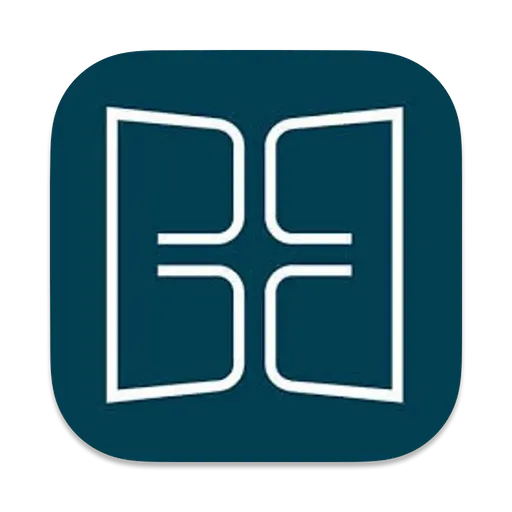

<p align="center">
  
</p>

<h1 align="center">EG elektronisch auf dem Mac</h1>

<p align="center">
  Das Evangelische Gesangbuch elektronisch (MFchi) unter macOS —<br>
  mit Wine oder als eigenständige App über Wineskin.
</p>

<p align="center">
  
  
</p>

## Worum es geht

Das Evangelische Gesangbuch elektronisch gibt es nur für Windows. Wer im
Pfarramt oder in der Kirchenmusik einen Mac nutzt, braucht dafür bisher eine
Windows-Maschine oder eine virtuelle Maschine.

Dieses Repository beschreibt, wie das Programm mit Wine direkt auf dem Mac
läuft, und bringt ein Skript und ein Icon mit, damit es im Programme-Ordner
liegt wie jede andere App.

## Funktionen

- **Zwei Wege** — Wine über Homebrew oder ein Wineskin-Wrapper als
  eigenständige App
- **App im Programme-Ordner** — `create_eg_wine_app.sh` legt einen Starter
  „Evangelisches Gesangbuch“ samt Icon an
- **Textverarbeitung** — die nötige Registrierung von `tx4ole14.ocx` und
  `mfc42` ist beschrieben
- **Icon** — `eg-elektronisch.icns` und `eg-elektronisch.png`

## Kompatibilität

| Gegenstück | Nötig | Zuletzt geprüft gegen |
|------------|-------|-----------------------|
| macOS | mit Homebrew und Wine | macOS 14.5 Sonoma, Apple Silicon |
| EG elektronisch | Installationsdatei von MFchi und die Text-CD | — |

## Installation

Voraussetzung ist eine gültige Lizenz des Programms: die Installationsdatei
von MFchi und die CD mit den Texten.

### Installation mit Wine

#### 1. Download der aktuellen Version von MFchi

Lade die aktuelle Version von MFchi von der offiziellen Website herunter:
[MFchi Download](https://www.mfchi.org/epages/es122753.sf/de_DE/?ObjectPath=/Shops/es122753/Categories/Support/Download/Updates/Update_auf_aktuelle_Version)

#### 2. Installation von Homebrew

Öffne das Terminal und installiere Homebrew mit dem folgenden Befehl:

```sh
/bin/bash -c "$(curl -fsSL https://raw.githubusercontent.com/Homebrew/install/HEAD/install.sh)"
```
#### 3. Installation von Wine und Winetricks

Installiere Wine und Winetricks über Homebrew:

```sh
brew install --cask wine-stable
brew install winetricks
```

#### 4. Installation der MFchi-Datei

Starte die Installation der MFchi-Datei über Wine. Navigiere im Terminal zu dem Verzeichnis, in dem die heruntergeladene Datei gespeichert ist, und führe den folgenden Befehl aus:

```sh
wine path/to/mfchi-setup.exe
```

#### 5. Installation der erforderlichen Dateien mit Winetricks

Die Datei mfc42.exe wird für die interne Textverarbeitung von MFchi Pro benötigt und ist eventuell auch für die Installation erforderlich. Installiere sie mit Winetricks:

```sh
winetricks mfc42
```

#### 6. Registrierung der DLL für die Textverarbeitung

Für die interne Textverarbeitung muss die tx4ole14.ocx-Datei registriert werden. Führe den folgenden Befehl aus (passe den Pfad zur Installation entsprechend an):

```sh
wine regsvr32 "C:\MFchi\tx4ole14.ocx"
```

#### 7. Starten des Programms über das Terminal

Du kannst das Evangelische Gesangbuch Elektronisch nun über das Terminal starten:

```sh
wine "C:/MFchi/mfbo2a32.exe"
```

#### 8. Import der Dateien von der CD und Update

Importiere die notwendigen Dateien von der CD, um das Programm vollständig nutzen zu können und Update alle Textversionen.

#### 9. Erstellen eines Shortcuts mit Icon im Applications-Ordner

Um das Programm bequem über den Applications-Ordner starten zu können, führe das folgende Skript aus, um einen Shortcut mit Icon zu erstellen. Dazu die Dateien [create_eg_wine_app.sh](create_eg_wine_app.sh) und [eg-elektronisch.icns](eg-elektronisch.icns) herunterladen.

Vorher im Skript prüfen:

- `WINDOWS_APP_PATH` muss auf die installierte `mfbo2a32.exe` zeigen. Bei der Installation wie oben ist das `C:/MFchi/mfbo2a32.exe`; die Vorgabe im Skript ist `C:/Program Files (x86)/mfbo2a32.exe`.
- Das Icon wird in `~/Downloads/eg-elektronisch.icns` erwartet. Liegt es woanders, den Pfad beim Aufruf angeben: `ICON_PATH=/pfad/zu/eg-elektronisch.icns ./create_eg_wine_app.sh`

**Skript ausführbar machen:**

```sh
chmod +x create_eg_wine_app.sh
```

Führe das Skript aus:

```sh
./create_eg_wine_app.sh
```

Nun solltest du die Anwendung "Evangelisches Gesangbuch" im Applications-Ordner sehen und starten können.

### Installation mit Wineskin Winery

Verpackt das Programm samt Wine-Umgebung in eine eigenständige Mac-App, die sich auf andere Macs kopieren lässt.

#### 1. Installation von Homebrew

Falls Homebrew noch nicht installiert ist, führe diesen Befehl im Terminal aus:

```sh
/bin/bash -c "$(curl -fsSL https://raw.githubusercontent.com/Homebrew/install/HEAD/install.sh)"
```

#### 2. Wineskin Winery herunterladen und installieren

Installiere Wineskin Winery über Homebrew:

```sh
brew install --cask --no-quarantine gcenx/wine/wineskin
```

#### 3. Wineskin Winery einrichten

1. Öffne Wineskin Winery und klicke auf "Update" oder "Download", um sicherzustellen, dass du die neueste Engine und Wrapper-Version hast.
2. Klicke auf "+", um einen neuen Wrapper zu erstellen.
3. Gib deinem Wrapper einen Namen, z.B. "EG", und klicke auf "Create". 

#### 4. Wrapper konfigurieren

1. Nachdem der Wrapper erstellt wurde, öffne ihn. Du findest ihn in deinem Benutzerverzeichnis unter `~/Applications/Wineskin`.
2. Klicke auf "Install Software" und wähle "Choose Setup Executable".
3. Navigiere zu der MFchi-Setup-Datei und installiere sie.
4. Den Suchvorgang kannst du abbrechen.
5. Nach der Installation wird gefragt, ob das Programm gestartet werden soll. Das kannst du verneinen.
6. Nachdem die Installation abgeschlossen ist, wirst du gefragt, welche Datei gestartet werden soll. Wähle die Hauptausführbare Datei aus, z.B. `C:/Program Files (x86)/bibel digital/mfbo2a32.exe`.

#### 5. Zusätzliche Bibliotheken und DLLs installieren

1. Öffne den Wrapper und klicke auf "Advanced".
2. Gehe zu "Tools" und öffne "Winetricks".
3. Installiere `mfc42` über Winetricks.

#### 6. Registriere die `tx4ole14.ocx`-Datei

1. Öffne den Wrapper und klicke auf "Advanced".
2. Gehe zu "Tools" und öffne "Commandline".
3. Registriere die `tx4ole14.ocx`-Datei:
```sh
regsvr32 "C:\Program Files (x86)\bibel digital\tx4ole14.ocx"
```

#### 7. Icon hinzufügen

1. Lade [eg-elektronisch.icns](eg-elektronisch.icns) oder [eg-elektronisch.png](eg-elektronisch.png) als Icon herunter.
2. Öffne den Wrapper und klicke auf "Advanced".
3. Gehe zu "Configuration" und klicke auf "Browse" neben dem Icon-Feld.
4. Wähle das Icon aus, das du verwenden möchtest.

#### 8. Wrapper als eigenständige App nutzen

1. Schließe alle offenen Fenster von Wineskin.
2. Der Wrapper, der nun eine vollständige Wine-Umgebung sowie die installierte MFchi-Anwendung enthält, kann nun wie jede andere Mac-Anwendung verwendet werden.
3. Starte das Programm durch einen Doppelklick. Bibel Digital sollte nun starten.
4. Über Einbindung die Textdateien importieren und über Online die Updates einspielen.
5. Kopiere den Wrapper einfach auf einen anderen Mac, und es sollte sofort einsatzbereit sein.

## Versionen

Was sich wann geändert hat, steht in [CHANGELOG.md](CHANGELOG.md) — nach
[Keep a Changelog](https://keepachangelog.com/de/1.1.0/), aus Sicht der
Nutzer:innen geschrieben.

## Aufbau

```
eg-elektronisch-mac
├── create_eg_wine_app.sh   — legt den Starter in /Applications an
├── eg-elektronisch.icns    — Icon für den Starter
├── eg-elektronisch.png     — Icon für Wineskin
└── tests/                  — prüft das Skript, ohne /Applications anzufassen
```

## Mitmachen

Erfahrungen mit anderen macOS-Versionen oder Programmständen sind
willkommen — gern als [Issue](https://github.com/Revisor01/eg-elektronisch-mac/issues).
Sicherheitslücken bitte vertraulich melden, wie in [SECURITY.md](SECURITY.md)
beschrieben. Pull Requests laufen durch Tests und einen Secret-Scan; siehe
[CONTRIBUTING.md](CONTRIBUTING.md).

## Lizenz

Anleitung, Skript und Icon: [MIT](LICENSE) © 2024–2026 Simon Luthe

## Hinweis

Dies ist eine unabhängige Anleitung. Das Evangelische Gesangbuch elektronisch
und MFchi sind Produkte ihrer jeweiligen Rechteinhaber; Programm und Texte
sind nicht Teil dieses Repositorys und brauchen eine eigene Lizenz.

## Kontakt

Pastor Simon Luthe · [mail@simonluthe.de](mailto:mail@simonluthe.de) ·
[simonluthe.de](https://simonluthe.de)
